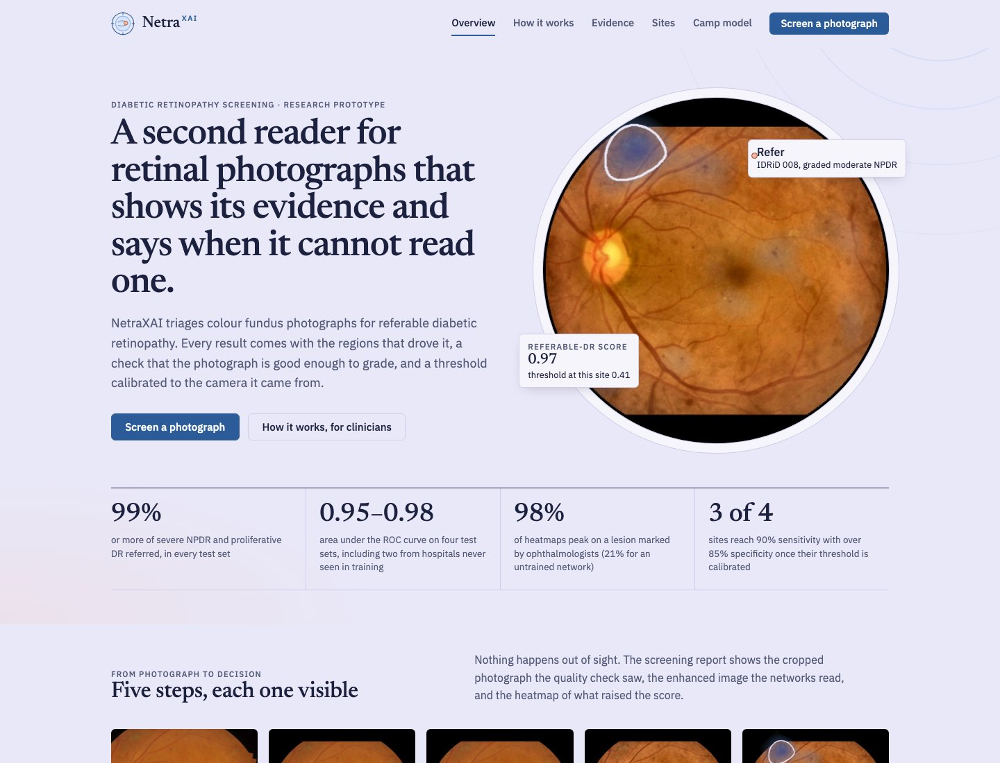

# Fundalux

*Fundus + lux: light into the back of the eye.* Previously called NetraXAI; renamed because Netra.AI and MadhuNetrAI are existing diabetic-retinopathy screening tools.

Explainable screening for referable diabetic retinopathy. Fundalux reads a colour fundus photograph,
refuses it if it cannot be graded, and otherwise reports whether referable retinopathy is suspected,
with a heatmap of the regions that drove the decision and a threshold calibrated to the camera.

> Research prototype. Not a medical device, no regulatory clearance, not prospectively validated.
> A clinician must confirm every result.



More screenshots of every part of the system are in [demo/](demo/README.md).

## What it does

| | |
|---|---|
| **Refuses unreadable photographs** | A dedicated quality network (AUC 0.993 against human quality labels) rejects blurred, dark or glared photographs, says why, and asks for a retake. |
| **Shows its evidence** | Grad-CAM heatmaps averaged over the three networks. On 81 photographs with lesions outlined by ophthalmologists, the hottest point fell on a lesion in 98% of cases (21% for untrained networks). |
| **Is calibrated per camera** | Each camera shifts the scores. A site grades a few hundred of its own photographs; Fundalux fits that site's threshold and reports the accuracy to expect, measured on photographs it did not tune on. |
| **Explains itself to clinicians** | A long-form guide (grading scale, every processing step, thresholds, how to read a heatmap, limitations, model card) and an evidence page with ROC curves, results by grade and robustness tests. Both print to PDF. |

## Results

Referable DR = ICDR moderate NPDR or worse. Photographs accepted by the quality gate. Three-network
ensemble (EfficientNet-B3, EfficientNetV2-S, ConvNeXt-Tiny), training run 2 (18 Nov 2026).

| Test set | AUC | Global threshold sens. / spec. | Site threshold sens. / spec. | 90% / 85% target |
|---|---|---|---|---|
| APTOS 2019 (India) | 0.978 | 99.3% / 83.4% | 91.9% / 93.1% | met |
| IDRiD (India, external) | 0.978 | 97.5% / 76.2% | 92.2% / 92.3% | met |
| Messidor-2 (France, external) | 0.967 | 96.5% / 75.6% | 92.8% / 86.7% | met |
| EyePACS (USA) | 0.948 | 91.6% / 80.4% | 93.3% / 76.2% | not met |

- **What matters clinically:** severe NPDR and proliferative DR are referred in 99–100% of cases in
  every test set. Misses are mostly moderate NPDR; false referrals are mostly mild NPDR.
- **How site figures were measured:** APTOS and EyePACS site thresholds were tuned on validation photographs
  and measured on separate test photographs. IDRiD and Messidor-2 never contributed to training; their
  site figures are cross-fitted (tuned on one half, tested on the other, 20 random halvings).
- **Limitations:**
  - diabetic macular oedema is not assessed;
  - no other eye disease is detected;
  - moderately degraded photographs pass the gate and are over-referred;
  - nothing has been validated on smartphone cameras or prospectively.
- **Full detail:** the app's *Evidence* and *How it works* pages, generated from the model files
  in `models/`.

## Run it

The trained weights (445 MB) are not in this repository. Download `fundalux_weights_run2.zip` from https://drive.google.com/file/d/1mTRrxddgEA2I2h_kgvIn5MRn5Mpsi65i/view?usp=drive_link and unzip it in the project folder; [models/README.md](models/README.md)
explains how to check it.


```bash
python3 -m venv .venv && source .venv/bin/activate    
pip install -r requirements.txt

uvicorn server.main:app --port 8000                    # open http://localhost:8000
FUNDALUX_ADMIN_TOKEN=change-me uvicorn server.main:app --port 8000   # also allows site calibration

pytest                                                 # 79 tests
```

To host it, use the `Dockerfile`: it builds one container, CPU only, with no PyTorch.

Full documentation (software requirements specification, model documentation, function and API reference) is in
[docs/Fundalux_System_Documentation.pdf](docs/Fundalux_System_Documentation.pdf). It is generated from the code and
the model bundle; regenerate it after retraining or code changes with `python scripts/build_docs_pdf.py`
(needs `reportlab`; the screenshots in `docs/screens/` are taken from the running app).

### Pages

| Page | For |
|---|---|
| `/` Overview | What it is, results at a glance, intended use, limitations |
| `/how-it-works` | The clinician's guide and model card |
| `/evidence` | ROC curves with operating points, results by grade, confusion matrices, heatmap validation, robustness |
| `/screen` | Screen a photograph or a sample, simulate camera problems, switch sites, print the report |
| `/sites` | Site thresholds and calibrating a new site |
| `/camp` | Discrete-event model of a screening camp with and without AI triage |
| `/review` | Blinded clinician review: grade a fixed set of photographs without seeing the system's answer |
| `/review/results` | For the organiser: agreement with clinicians, results against the reference, disagreements, CSV export |
| `/api/docs` | The JSON API |

### Command line

```bash
python -m fundalux.cli photo.jpg --save-dir out              # screen one photograph
python -m fundalux.calibrate --site "PHC Nanded" --labels labels.csv --images photos/
python -m fundalux.screening_sim --metrics models/metrics.json
```

## Clinician review

The way to find out whether Fundalux helps is to have clinicians grade the same photographs. `/review`
runs that as a blinded study:

- **The set:** 60 IDRiD test photographs with expert reference grades, spread over all five grades
  (`review/`). Fundalux never trained on them. Build another set with
  `python scripts/build_review_set.py --images DIR --labels labels.csv`, or upload one on
  `/review/results`.
- **What reviewers see and record:** one photograph at a time under a neutral number, with zoom. They
  record gradable or not, the ICDR grade, "refer for another reason" (for example macular oedema),
  confidence and a note. Grading works from the keyboard (`0`–`4`, `U`, `R`, `Z`, `Enter`), each reviewer
  gets their own photograph order, and they can stop and resume.
- **Teaching mode:** shows Fundalux's answer and heatmap after the reviewer commits. Those answers are
  marked and reported separately.
- **What the organiser gets:** reviewer–Fundalux and reviewer–reviewer agreement (kappa), each reviewer
  and Fundalux against the reference on the same photographs, quality-gate agreement, a gallery of
  disagreements with reviewers' notes, and a CSV of every answer.

```bash
FUNDALUX_ADMIN_TOKEN=organiser-secret FUNDALUX_REVIEW_TOKEN=code-for-doctors uvicorn server.main:app --port 8000
# send clinicians to /review with the review code; read the results at /review/results with the admin token
```

## How it is built

```
photograph ─► crop to retina ─► quality gate ──refused──► reason + retake advice
                                    │ accepted
                                    ▼
                 illumination correction + CLAHE
                                    ▼
          3 networks (ONNX Runtime) ─► averaged score ─► site threshold ─► referral advice
                                    └─► closed-form Grad-CAM ─► averaged heatmap
```

| Path | What it is |
|---|---|
| `fundalux/` | The core package, shared by training and serving: `preprocess`, `quality`, `degrade`, `inference` (ONNX Runtime and PyTorch backends, closed-form Grad-CAM), `pipeline`, `sites` + `calibrate`, `metrics`, `screening_sim`, and training-only `models`, `data`, `datasets`, `gradcam`, `export` |
| `server/` | FastAPI app: `main.py` (pages and API), `report.py` (the evidence, computed from the model files), `templates/`, `static/` (CSS design system, plain JavaScript, self-hosted fonts) |
| `review/` | The clinician review set: photographs under neutral ids, `set.json` with reference grades and the model's answers; answers are stored in `responses.sqlite3` (not in version control) |
| `Fundalux_Kaggle_Training.ipynb` | Trains and evaluates everything on a free Kaggle GPU. Generated from `scripts/notebook_src.py`; rebuild with `python scripts/build_notebook.py` |
| `models/` | The trained bundle: weights, ONNX serving copies, `config.json`, `metrics.json`, `sites.json`, reports and figures |
| `app/` | The earlier Streamlit app, kept as a local alternative (`streamlit run app/app.py`) |
| `tests/`, `scripts/` | Tests; notebook build and smoke test, site profiles, web illustrations |
| `matlab/` | Untested MATLAB/Simulink scripts from the project's original plan |

### Design decisions

- **Splits are by patient**, so both eyes of one person are always on the same side of a split.
- **Two hospitals are held out entirely** (IDRiD, Messidor-2) to show behaviour on unseen cameras.
- **Thresholds are frozen before testing**, and nothing is reported on its own tuning data.
- **Sensitivity first:** thresholds target 93% sensitivity, a margin above the 90% goal.
- **Sources are balanced in training**, so the networks cannot use "which camera took this?" as a
  shortcut to the label.
- **Heatmaps are validated** against ophthalmologists' lesion masks and compared with untrained networks.
- **Serving needs no PyTorch.** The head after each network's last feature map is pooling plus one
  linear layer (and a LayerNorm for ConvNeXt), so Grad-CAM has a closed form. ONNX Runtime returns the
  feature maps, and the heatmaps are computed with NumPy. Tests check this matches PyTorch's autograd
  to within 1e-4.
- **Privacy:** photographs are processed in memory, never stored or logged.
- **Hosting safety:** changing thresholds needs an admin token; uploads have size limits; a strict
  Content-Security-Policy allows no inline or third-party scripts.

## Training history

| Run | Date | Models | Specificity at global threshold | Notes |
|---|---|---|---|---|
| 1 | 16 Nov 2026 | EfficientNet-B3 @384 | 49–73% | Kept in `models_run1/` |
| 2 | 18 Nov 2026 | B3 @512 + V2-S @448 + ConvNeXt-T @448, balanced sources | 76–83% | In use; per-site thresholds added afterwards |

The notebook now also trains the quality gate to refuse moderately degraded photographs (severity ≥ 0.3),
the main known weakness of run 2. This was chosen after seeing run 2's test results and has not been
trained yet.

## Data and credits

Training data is downloaded by the notebook and is not part of this repository. Check each dataset's
terms before any use beyond research and education.

- EyePACS: Kaggle Diabetic Retinopathy Detection (2015), resized copy `tanlikesmath/diabetic-retinopathy-resized`.
- APTOS 2019 Blindness Detection (Aravind Eye Hospital), copy `mariaherrerot/aptos2019`.
- IDRiD: Porwal et al., *Indian Diabetic Retinopathy Image Dataset*, CC BY 4.0. The three images in
  `samples/`, the 60 photographs in `review/` and the illustrations in `server/static/img/` are derived
  from IDRiD test images.
- Messidor-2 with adjudicated grades (Krause et al.), copy `mariaherrerot/messidor2preprocess`.
- EyeQ quality labels: Fu et al., *Evaluation of Retinal Image Quality Assessment Networks in Different
  Color-spaces*, MICCAI 2019.
- Fonts: Newsreader and IBM Plex Sans, SIL Open Font License (licences in `server/static/fonts/`).
